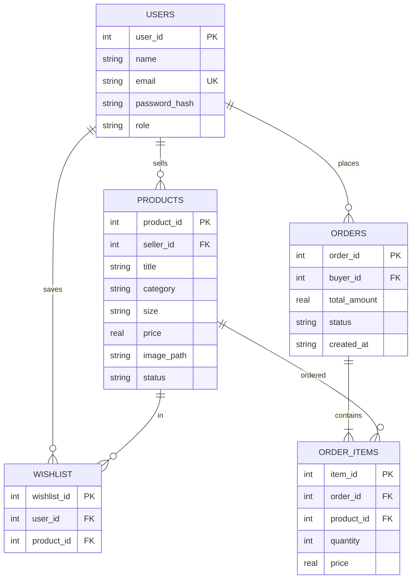

# ReWear ♻️ - Pre-Loved Clothes Reselling Platform

> **A Beginner-Friendly Sustainable Fashion Marketplace for 2nd-Year BTech Mini-Project**  
> Built strictly using **Python**, **Streamlit**, **SQLite (sqlite3)**, and **Pillow (PIL)**.

---

## 📖 Project Overview

**ReWear** is a circular economy web application that facilitates the reselling and buying of gently-used, pre-loved clothes. The project aims to reduce textile waste, conserve water, and make fashion affordable by connecting buyers and sellers directly.

### 🛠️ Technology Stack
- **Language:** Python (3.10+)
- **Frontend / UI:** Streamlit
- **Database:** SQLite (`sqlite3` standard library module)
- **Image Processing:** Pillow (`PIL`)
- **Security:** `hashlib` & `os` standard libraries (PBKDF2-HMAC-SHA256 with 16-byte random salt)

---

## 📂 Project File Structure

```text
rEwEAR/
├── app.py              # Main application entry point, sidebar navigation, routing & session state
├── database.py         # SQLite setup, 5 relational tables, parameterized queries, & sample data seeder
├── auth.py             # User registration, login, PBKDF2 password hashing, and session management
├── products.py         # Seller listing form, Pillow image resizing/saving, and product card UI
├── wishlist_cart.py    # Marketplace search/filters, wishlist management, and shopping cart
├── orders.py           # Checkout handling, buyer order history, seller dashboard, and admin view
├── requirements.txt    # Project dependencies (streamlit, pillow)
├── README.md           # Project documentation, architecture, and setup instructions
├── .gitignore          # Ignores rewear.db, uploads/, and __pycache__/
└── uploads/            # Automatically created directory storing resized clothing photos
```

---

## 🗄️ Database Architecture (5 Tables in `rewear.db`)

All tables are created automatically on the first application launch:



1. **`users`**: Stores user profiles. Role can be `'buyer'`, `'seller'`, or `'admin'`.
2. **`products`**: Clothing listings with seller reference, category, size, price, image path, and status (`'available'` or `'sold'`).
3. **`wishlist`**: Many-to-many relationship mapping users to saved clothing items.
4. **`orders`**: Stores checkout records, total purchase amount, status, and timestamp.
5. **`order_items`**: Line items within each order linking to specific products and purchase prices.

---

## ✨ Features Implemented

1. **Role-Based Authentication (`auth.py`):**
   - User registration and login for Buyers, Sellers, and Admins.
   - Secure password hashing with `hashlib.pbkdf2_hmac('sha256', ...)` with 100,000 iterations and a unique 16-byte random cryptographic salt. **No plain text passwords are ever stored.**
   - Form validation for empty inputs, valid email format regex, and matching passwords.

2. **Image Processing & Seller Uploads (`products.py`):**
   - Sellers upload photos of their clothes.
   - Pillow (`PIL`) automatically scales and thumbnails images to a standard maximum size of 600×600 px, converts RGBA to RGB for safe storage, and saves them with timestamped filenames in `uploads/`.

3. **Search & Multi-Attribute Filters (`wishlist_cart.py`):**
   - Real-time text search by clothing title or style.
   - Filter dropdowns by Category (T-Shirts, Shirts, Jeans, Dresses, Jackets, Ethnic Wear, Hoodies, etc.) and Size (XS, S, M, L, XL, etc.).
   - Sorting by Price (Low to High, High to Low) or Newest First.

4. **Wishlist (`wishlist_cart.py`):**
   - Logged-in users can toggle items into their wishlist with a single click.
   - Dedicated Wishlist page displaying all saved clothes.

5. **Shopping Cart in Session State (`wishlist_cart.py`):**
   - Fast client-side cart stored in `st.session_state["cart"]`.
   - Add/remove items with instant subtotal and free eco-packaging calculations.

6. **Transactional Checkout (`orders.py`):**
   - Validates buyer contact details and delivery address.
   - Atomically records the order in `orders`, items in `order_items`, updates product status to `'sold'`, and clears the user's cart.
   - Celebrates successful order with Streamlit balloons (`st.balloons()`).

7. **Order History & Dashboards (`orders.py`):**
   - **Buyer Order History:** Detailed view of past purchases and dates.
   - **Seller Dashboard:** Tracks total listings, active items, sold items, and total revenue earned in ₹.
   - **Admin Control Panel:** Platform KPIs (total users, live products, orders, and GMV) with data tables for auditing.

8. **Security & Parameterized Queries:**
   - **100% Parameterized SQL (`?` placeholders)** used across all database queries to prevent SQL Injection attacks.

9. **Pre-Seeded Demo Data (`database.py`):**
   - On the first run, the database automatically initializes 3 demo users and 8 varied sample clothes with Pillow-generated placeholder photos so the demo is never empty.

---

## 🚀 How to Run the Project

### Step 1: Install Dependencies
Open your terminal/command prompt in the project root directory and run:

```bash
pip install -r requirements.txt
```

### Step 2: Run the Streamlit Application
Execute the following command:

```bash
streamlit run app.py
```

The application will automatically open in your default browser at `http://localhost:8501`.

---

## 🔑 Pre-Seeded Demo Test Accounts

For demonstration, evaluation, or testing, you can log in immediately using these pre-created accounts:

| Role | Email Address | Password | Purpose |
| :--- | :--- | :--- | :--- |
| **🛡️ Admin** | `admin@rewear.com` | `Admin@123` | View full system stats, all users, all products & orders |
| **🏪 Seller** | `seller@rewear.com` | `seller123` | List new clothes, view seller dashboard & sales revenue |
| **🛍️ Buyer** | `buyer@rewear.com` | `buyer123` | Browse clothes, add to wishlist, cart & checkout |

*(You can also register a new account anytime via the "Create New Account" tab!)*

---

## 🎓 Viva & Project Evaluation Q&A

**Q1: How do you prevent SQL Injection in this project?**  
*Answer:* We use parameterized SQL queries with `?` placeholders everywhere in `database.py`, `auth.py`, `wishlist_cart.py`, and `orders.py`. User input is passed as a tuple of parameters to SQLite rather than string formatting (`f"SELECT... {input}"`), preventing any malicious SQL injection.

**Q2: How are passwords stored securely?**  
*Answer:* We use Python's built-in `hashlib.pbkdf2_hmac` with SHA-256 and 100,000 iterations, combined with a randomly generated 16-byte cryptographic salt via `os.urandom(16).hex()`. The stored string is `<salt>$<hash>`. When checking login, the password is rehashed with the same salt and compared using constant-time comparison `hmac.compare_digest`.

**Q3: How does Pillow (PIL) optimize image uploads?**  
*Answer:* Uploaded images vary in dimension and file size. In `products.py`, Pillow converts incoming images to RGB mode and scales them down proportionally using `image.thumbnail((600, 600), Image.Resampling.LANCZOS)` before saving them to disk as compressed JPEGs, ensuring fast loading and consistent card layouts.

**Q4: How does the Cart work in Streamlit?**  
*Answer:* Streamlit reruns scripts on every interaction. To persist the cart across user clicks, we maintain `st.session_state["cart"]` as a list of `product_id`s, allowing users to browse between pages without losing their selected items.
